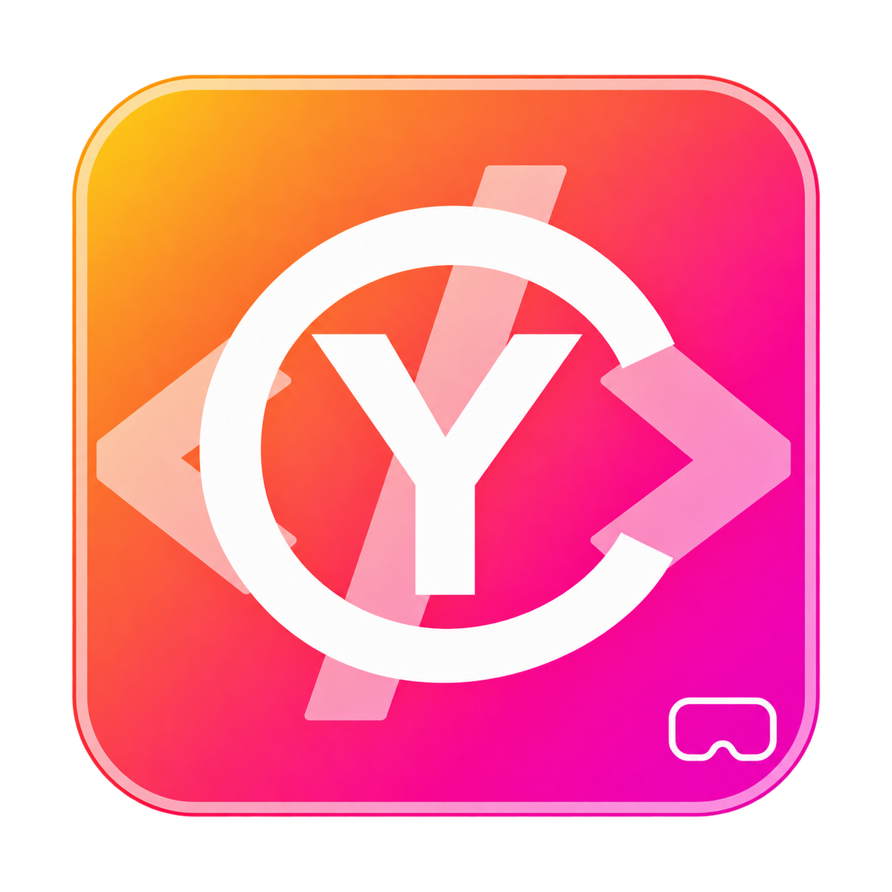
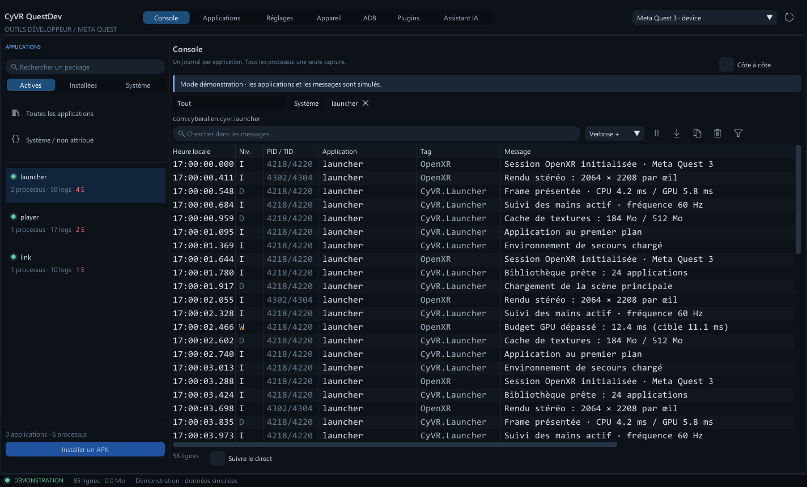
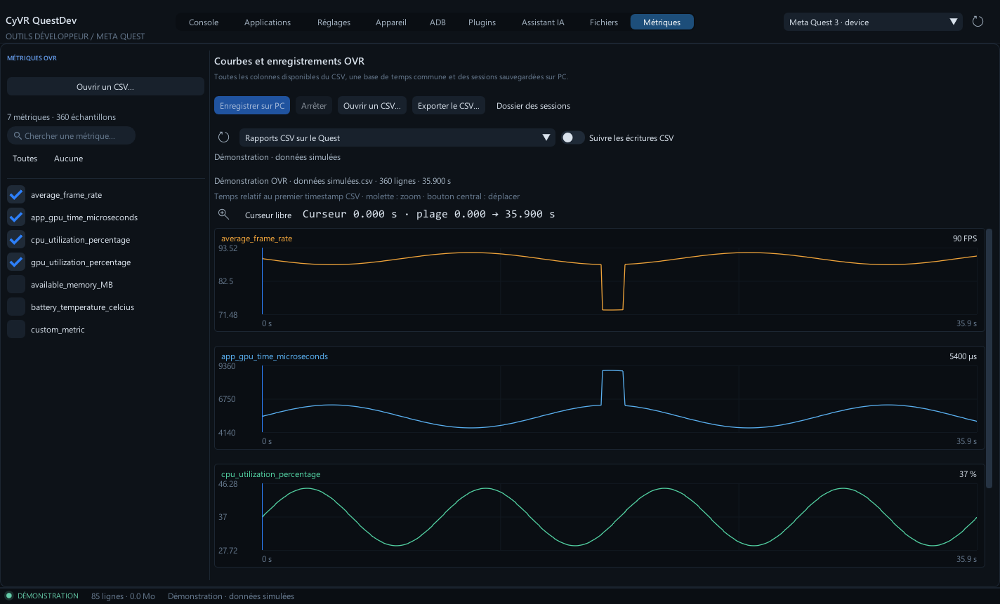

<table width="100%">
  <tr>
    <td width="300" align="left" valign="top">
      <a href="docs/INSTALLATION.md">Guide d’installation</a><br>
      <a href="docs/LOGS.md">Guide du journal</a><br>
      <a href="https://github.com/MrMybal/CyVR_QuestDev">Dépôt</a><br><br>
      <sub>README</sub><br>
      <a href="README.md">English</a> · <a href="README.fr.md">Français</a>
    </td>
    <td width="400" align="center" valign="middle">
      
    </td>
    <td width="300" align="right" valign="top">
      <p><sub>Licence de l’application</sub><br><a href="LICENSE"><strong>GPL-3.0-only</strong></a></p>
      <p><sub>Version</sub><br><a href="docs/releases/v0.9.0-alpha.1.fr.md"><strong>0.9.0-alpha.1</strong></a><br><strong>ALPHA</strong></p>
      <p><a href="https://github.com/MrMybal/CyVR_QuestDev/releases/download/v0.9.0-alpha.1/CyVR_QuestDev-0.9.0-alpha.1-Windows-x64-Setup.exe"><strong>Télécharger pour Windows</strong></a><br><sub>Windows 10/11 x64 · installateur</sub></p>
    </td>
  </tr>
</table>

<h1 align="center">CyVR QuestDev</h1>

Un ensemble d’outils Windows pour les développeurs Meta Quest. Séparez les journaux de chaque application, gérez le casque et ses fichiers, affichez son écran sur le PC et enregistrez les performances OVR depuis un même espace. L’assistant IA facultatif, le serveur MCP et le SDK Python utilisent les mêmes opérations QuestDev.

> **ALPHA · 0.9.0-alpha.1**
>
> Une version expérimentale pour les essais et les retours. Certaines fonctions dépendent du firmware du casque et d’applications Quest externes. Consulter les [notes de version et limites connues](docs/releases/v0.9.0-alpha.1.fr.md).

[](docs/images/console.png)

## À propos de CyVR QuestDev

Ouvrez un package dans **Console** pour suivre ses journaux, y compris ses sous-processus, sans mélanger les autres applications. Comparez deux applications côte à côte, recherchez et filtrez les messages, sélectionnez le texte **RAW** original ou triez les colonnes. Revenir en bas réactive le suivi du direct. La capture continue pendant la pause d’une vue, dans les limites de lignes et de mémoire choisies.

Les neuf pages possèdent leur propre navigation : **Console, Applications, Réglages, Appareil, ADB, Plugins, Assistant IA, Fichiers et Métriques**. Les actions de l’appareil regroupent le mirroring et les captures ; ADB affiche les commandes et leurs sorties ; Fichiers propose des transferts immédiats ou un lot préparé facultatif. Métriques suit les rapports CSV OVR et sauvegarde les sessions sur PC ; cette page ne lance pas d’application VR à votre place.

[](docs/images/metrics-curves.png)

## Fonctionnalités

- **Journaux par application** : attribution par package et sous-processus, suivi de la durée de vie des processus, onglets et comparaison indépendants, filtres de niveau/tag/PID/texte, sélection et copie RAW, tris combinés et export texte UTF-8 ou JSON Lines. La rétention par défaut de 50 000 lignes / 64 Mio se règle dans Réglages.
- **Applications** : catégories installées/actives/système, compteurs après filtrage, installation d’APK, lancement et arrêt.
- **Actions de l’appareil** : mirroring H.264 avec audio PC, plein écran, recadrage, qualité et enregistrement MKV facultatif ; captures d’écran, vidéo Android MP4, liens navigateur, traces Perfetto et commandes GPU/HUD/CSV, ADB Wi-Fi, proximité, Guardian et alimentation selon le firmware.
- **Fichiers** : volets PC/Quest, sélection multiple, chemins et filtres indépendants, transferts immédiats ou lot séquentiel préparé, annulation, reprise et arrêt sur erreur. Les transferts concernent les fichiers réguliers ; les dossiers Quest peuvent être créés, renommés et supprimés lorsqu’ils sont vides.
- **Métriques et plugins** : courbes des colonnes disponibles dans les CSV OVR, navigation temporelle commune et curseur fixé, suivi des écritures CSV, enregistrement sur PC et import/export CSV. Configurez OVR Metrics et CyInsightOVR, sauvegardez des profils, reliez leurs services et récupérez les captures prises en charge par les plugins.
- **IA, MCP et SDK** : discussion Markdown, choix du modèle, réponse progressive, annulation et contexte inspectable. Codex peut appeler les outils natifs QuestDev ; les autres profils intégrés proposent actuellement du texte contextualisé. Les clients MCP externes et le SDK Python accèdent au catalogue d’opérations.
- **Apparence et mises à jour** : cinq thèmes, deux densités, préférence EN/FR sauvegardée pour les vues migrées et mise à l’échelle DPI. Les mises à jour GitHub proposent des canaux Alpha/stable, un téléchargement vérifié, le redémarrage et la sauvegarde/restauration.

La traduction de l’interface reste partielle. Les guides détaillés sont actuellement en français ; les commandes, packages, chemins et journaux capturés conservent leur contenu original.

---

## Installation

**Version disponible : Windows 10/11 x64.** L’application embarque Python, CyToolsCore/MCP, les plugins et le moteur de mirroring scrcpy. Les Android SDK Platform-Tools (**ADB**), les CLI/comptes des fournisseurs IA et les applications installées sur le Quest restent externes.

1. [Télécharger l’installateur Alpha 0.9.0](https://github.com/MrMybal/CyVR_QuestDev/releases/download/v0.9.0-alpha.1/CyVR_QuestDev-0.9.0-alpha.1-Windows-x64-Setup.exe) et suivre l’assistant. L’installation par utilisateur comprend des raccourcis et un désinstalleur ; aucun droit administrateur n’est demandé.
2. Autre possibilité : extraire **tout le [ZIP portable Windows x64](https://github.com/MrMybal/CyVR_QuestDev/releases/download/v0.9.0-alpha.1/CyVR_QuestDev-0.9.0-alpha.1-Windows-x64.zip)** et lancer `CyVR_QuestDev.exe`. Conserver les dossiers livrés à côté de l’exécutable.
3. Installer les [Android SDK Platform-Tools officiels](https://developer.android.com/tools/releases/platform-tools), activer le mode développeur du Quest, le brancher et accepter le débogage USB dans le casque. Choisir `adb.exe` dans **Réglages** si sa détection échoue.
4. Sélectionner le casque. Pour enregistrer les données OVR, installer OVR Metrics Tool sur le Quest et laisser tourner l’application à mesurer. Connecter explicitement un fournisseur IA pour utiliser l’assistant.

L’installateur n’est pas signé. Les [fichiers de release et empreintes SHA-256](https://github.com/MrMybal/CyVR_QuestDev/releases/tag/v0.9.0-alpha.1) comprennent les sources correspondantes. L’audio du mirroring nécessite Android 13+ et peut être indisponible selon l’app. Consulter les guides d’[installation](docs/INSTALLATION.md) et de [mirroring](docs/MIRRORING.md).

Pour une installation existante, ouvrir **Réglages → Mises à jour GitHub** et choisir le canal Alpha pour recevoir les préversions. Le [guide des mises à jour](docs/UPDATES.md) explique l’installation et la restauration.

## Sources, compilation et bibliothèques nécessaires

<details>
<summary>Compiler QuestDev depuis les sources sur Windows</summary>

Utiliser Visual Studio 2022 avec les outils C++17/C++20, CMake 3.20+, Ninja, Git et Python 3.11+. Le programme natif utilise C++17 ; l’éditeur de texte commun et son adaptateur utilisent C++20.

```powershell
git clone https://github.com/MrMybal/CyVR_QuestDev.git
cd CyVR_QuestDev
.\build.ps1 -Test
.\build.ps1 -Run
```

CyUI 1.2.0 est épinglé au commit `ff023e646c6a3038b3dfbfd53f6d2b4a2f5955e3` dans `cmake/CyUI.cmake`. La compilation extrait cette révision Git exacte d’un dépôt voisin `CyUI`/`CyImgui_Interface`, accepte `CYUI_ROOT` ou `-CyUIRoot`, ou la récupère par CMake. L’archive Source correspondante fournit aussi le snapshot CyUI épinglé à côté de QuestDev.

Seuls **Core, Plots, Images, DocumentViews et CodeEditor**, ainsi que leurs dépendances **Canvas/Code**, sont sélectionnés. Le programme fournit une seule instance de Dear ImGui ; Audio, Gallery et CEF sont désactivés. Consulter le [guide des modules et de compilation](docs/CYUI_MIGRATION.md).

```powershell
# Emplacement CyUI explicite et dossier de sortie distinct :
.\build.ps1 -Test -CyUIRoot ../CyUI -BuildDirectory build/cyui-migration
# Préparer le runtime de l’assistant et le mirroring dans les sources :
.\runtime\setup.ps1
python tools/setup_mirroring.py
# Parcourir l’interface sans connexion ADB :
.\build\windows\CyVR_QuestDev.exe --demo --compare --theme light-grey
```

L’exécutable par défaut est `build/windows/CyVR_QuestDev.exe`. Une compilation depuis les sources utilise les dossiers `assistant`, `runtime` et `plugins` ; l’EXE seul ne contient pas Python. Les versions des dépendances sont consignées dans `runtime/requirements.lock` et les [notices tierces](THIRD_PARTY.md). L’[architecture](docs/ARCHITECTURE.md) et les [instructions de packaging](docs/RELEASE.md) détaillent le développement.

</details>

---

## Licence

**CyVR QuestDev utilise la [GNU General Public License v3 uniquement](LICENSE) (`GPL-3.0-only`).** Copyright © 2026 Cyberalien. Consulter le [copyright et son périmètre](COPYRIGHT). Les composants tiers conservent leurs propres conditions.

### Bibliothèques et outils tiers

| Bibliothèque · sources | Licence · texte | Utilisation / périmètre |
| --- | --- | --- |
| [CyUI 1.2.0](https://github.com/MrMybal/CyUI) | [MIT](licenses/CyUI.txt) · [texte amont épinglé](https://github.com/MrMybal/CyUI/blob/ff023e646c6a3038b3dfbfd53f6d2b4a2f5955e3/LICENSE) | Interface native modulaire ; les modules sélectionnés sont liés à QuestDev. |
| [Dear ImGui](https://github.com/ocornut/imgui) | [MIT](licenses/ImGui.txt) | Widgets natifs et backends Win32/DX11 fournis par CyUI. |
| [ImGuiColorTextEdit](https://github.com/goossens/ImGuiColorTextEdit) | [MIT](licenses/CyUI-TextEditor.txt) | Éditeur RAW, ADB et JSON en lecture seule, via CyUI CodeEditor. |
| [Lexilla](https://github.com/ScintillaOrg/lexilla), [Scintilla](https://www.scintilla.org/ScintillaDownload.html), [SciTE](https://www.scintilla.org/SciTEDownload.html) | Notices permissives [Lexilla](licenses/CyUI-Lexilla.txt) · [Scintilla](licenses/CyUI-Scintilla.txt) · [SciTE](licenses/CyUI-SciTE.txt) | Moteurs syntaxiques, en-têtes et propriétés de langages de CyUI Code ; aucune application Scintilla ou SciTE n’est liée. |
| [CyToolsCore 0.10.1](https://github.com/MrMybal/CyToolsCore) | [MIT](LICENCES/CyToolsCore-MIT.txt) | Runtime local d’opérations, client HTTP et adaptateur MCP embarqués. |
| [SDK Python MCP](https://github.com/modelcontextprotocol/python-sdk) | [MIT et notices des dépendances Python](LICENCES/Python-dependencies.txt) | Transport MCP du runtime de l’assistant. |
| [CPython 3.13.17](https://github.com/python/cpython) | [PSF et notices des composants](https://github.com/python/cpython/blob/v3.13.17/LICENSE) | Runtime Python embarqué dans les distributions Windows ; sa licence complète accompagne aussi Python. |
| [nlohmann/json 3.11.3](https://github.com/nlohmann/json) | [MIT](LICENCES/nlohmann-json-MIT.txt) | Analyse et sérialisation JSON natives. |
| [Transports de fournisseurs CyUEMCPSDK](https://github.com/MrMybal/CyUEMCPSDK) | [MIT](LICENCES/ProviderTransports-MIT.txt) | Sources de transport adaptées ; les services et CLI des fournisseurs restent externes. |
| [scrcpy 5.0.1](https://github.com/Genymobile/scrcpy/tree/v5.0.1) | [Apache-2.0](LICENCES/scrcpy-Apache-2.0.txt) | Moteur embarqué utilisé pour le mirroring, dans une fenêtre vidéo native dédiée. |
| [FFmpeg](https://github.com/FFmpeg/FFmpeg), [libusb](https://libusb.info/) | [LGPL-2.1-or-later : FFmpeg](LICENCES/FFmpeg-LGPL-2.1.txt) · [libusb](LICENCES/libusb-LGPL-2.1.txt) | Bibliothèques partagées remplaçables de la distribution officielle scrcpy ; les sources correspondantes accompagnent l’archive Source. |
| [SDL](https://libsdl.org/), [dav1d](https://code.videolan.org/videolan/dav1d), [zlib](https://zlib.net/) | [zlib : SDL](LICENCES/SDL-zlib.txt) · [BSD : dav1d](LICENCES/dav1d-BSD.txt) · [zlib](LICENCES/zlib.txt) | Composants natifs et notices de la distribution de mirroring. |
| [Inno Setup 6.7.4](https://github.com/jrsoftware/issrc/releases/tag/is-6_7_4) | [Licence Inno Setup](LICENCES/Inno-Setup.txt) | Outil de création de l’installateur ; le Setup et le désinstalleur conservent ses notices. |
| [Android SDK Platform-Tools](https://developer.android.com/tools/releases/platform-tools) | [Conditions du SDK Android](https://developer.android.com/studio/terms) | Exécutable ADB externe, non embarqué dans QuestDev. |

Ce tableau indexe les principaux composants. Conserver les [notices tierces complètes](THIRD_PARTY.md), `LICENCES/`, `licenses/` et les notices des runtimes embarqués. OVR Metrics et CyInsightOVR sont des applications Quest externes ; QuestDev ne redistribue pas leurs APK/JAR.

## Références et liens

- [Notes de version et limites](docs/releases/v0.9.0-alpha.1.fr.md) · [Téléchargements](https://github.com/MrMybal/CyVR_QuestDev/releases) · [Suivi des problèmes](https://github.com/MrMybal/CyVR_QuestDev/issues).
- Guides : [journaux](docs/LOGS.md), [fichiers](docs/FILES.md), [métriques](docs/METRICS.md), [mirroring](docs/MIRRORING.md), [plugins](docs/PLUGINS.md) et [IA/MCP/SDK](docs/AI_MCP_SDK.md).
- [Exemple de SDK Python](examples/list_errors.py) · [Dépôt des sources](https://github.com/MrMybal/CyVR_QuestDev).
- [CyUI](https://github.com/MrMybal/CyUI) · [CyToolsCore](https://github.com/MrMybal/CyToolsCore) · [Projet associé : CyVR_UI, MIT](https://github.com/MrMybal/CyVR_UI).
