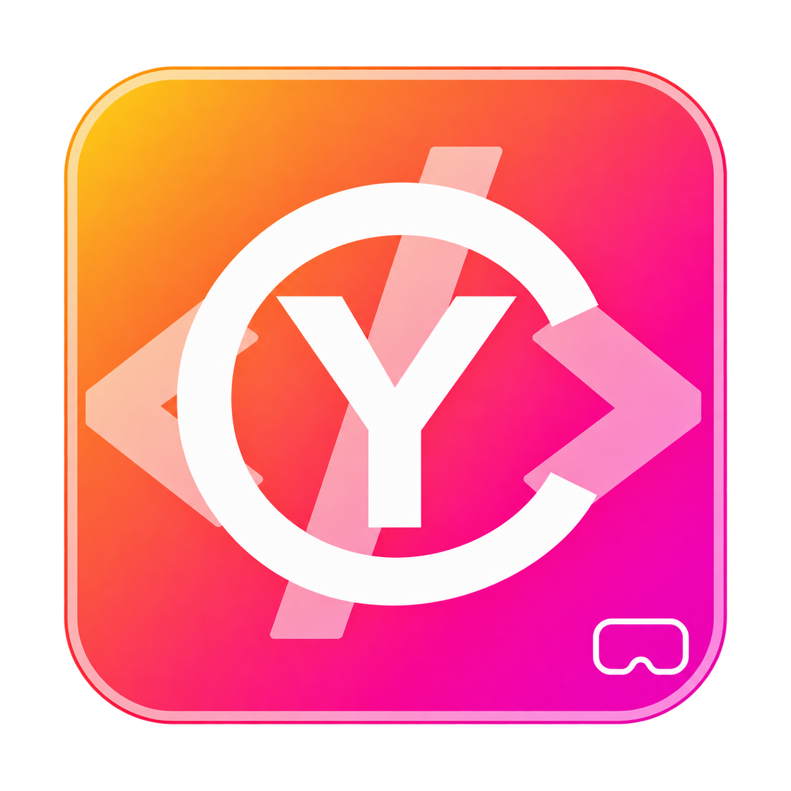
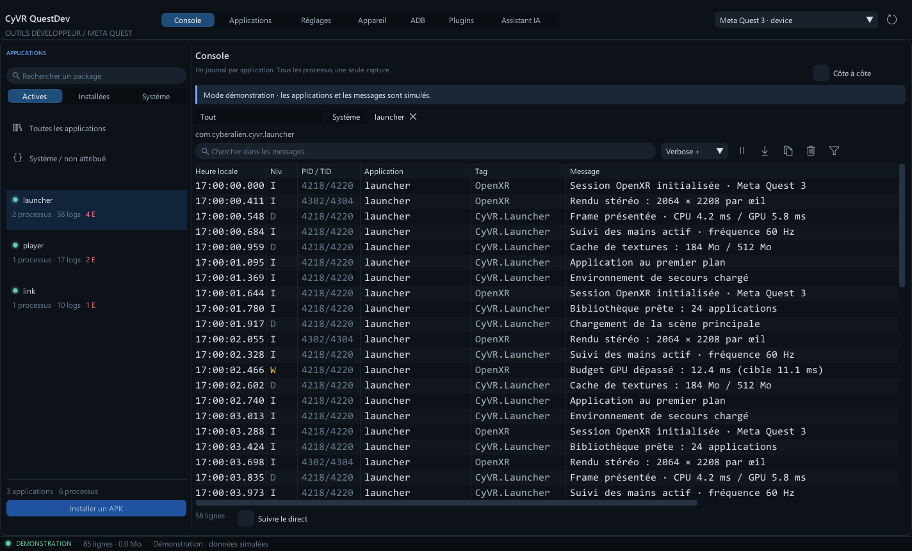
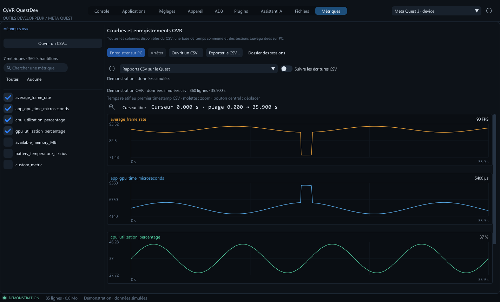

<table width="100%">
  <tr>
    <td width="300" align="left" valign="top">
      <a href="docs/INSTALLATION.md">Installation guide (FR)</a><br>
      <a href="docs/LOGS.md">Log guide (FR)</a><br>
      <a href="website/README.md">Showcase · local preview</a><br>
      <a href="https://github.com/MrMybal/CyVR_QuestDev">Repository</a><br><br>
      <sub>README</sub><br>
      <a href="README.md">English</a> · <a href="README.fr.md">Français</a>
    </td>
    <td width="400" align="center" valign="middle">
      
    </td>
    <td width="300" align="right" valign="top">
      <p><sub>Application license</sub><br><a href="LICENSE"><strong>GPL-3.0-only</strong></a></p>
      <p><sub>Version</sub><br><a href="docs/releases/v0.9.0-alpha.1.md"><strong>0.9.0-alpha.1</strong></a><br><strong>ALPHA</strong></p>
      <p><a href="https://github.com/MrMybal/CyVR_QuestDev/releases/download/v0.9.0-alpha.1/CyVR_QuestDev-0.9.0-alpha.1-Windows-x64-Setup.exe"><strong>Download for Windows</strong></a><br><sub>Windows 10/11 x64 · installer</sub></p>
    </td>
  </tr>
</table>

<h1 align="center">CyVR QuestDev</h1>

A Windows desktop toolkit for Meta Quest developers. Keep each application's logs separate, manage your headset and files, mirror its display, and record OVR performance data from one workspace. An optional AI assistant, MCP server and Python SDK use the same QuestDev operations.

> **ALPHA · 0.9.0-alpha.1**
>
> An experimental release for testing and feedback. Some features depend on the headset firmware and external Quest applications. Read the [version notes and known limitations](docs/releases/v0.9.0-alpha.1.md).

[](docs/images/console.png)

## About CyVR QuestDev

Open a package in **Console** to follow its logs, including subprocesses, without mixing in other applications. Compare two applications side by side, search and filter messages, select the original **RAW** text, or sort the column view. Returning to the bottom resumes live following. Capture continues while a view is paused, within the configured line and memory limits.

The nine pages have their own navigation: **Console, Applications, Settings, Device, ADB, Plugins, AI assistant, Files and Metrics**. Use Device actions for mirroring and captures, ADB for commands and task output, and Files for immediate transfers or an optional prepared batch. Metrics follows OVR CSV reports and saves sessions on the PC; it does not launch a VR application for you.

[](docs/images/metrics-curves.png)

## Features

- **Application logs:** package/subprocess attribution, process lifetime tracking, independent tabs and comparison, severity/tag/PID/text filters, RAW selection and copying, multi-column sorting, and UTF-8 text or JSON Lines export. The default retention budget is 50,000 lines / 64 MiB and can be changed in Settings.
- **Applications:** installed/running/system categories, counts after filtering, APK installation, launch and stop actions.
- **Device actions:** H.264 mirroring with PC audio, full screen, cropping, quality controls and optional MKV recording; screenshots, Android MP4 recording, browser links, Perfetto traces and firmware-dependent GPU/HUD/CSV, Wi-Fi ADB, proximity, Guardian and power controls.
- **Files:** PC/Quest panes, multiple selection, independent paths and filters, immediate transfers or a prepared sequential batch, cancellation, retry and stop-on-error. Transfers cover regular files; Quest folders can be created, renamed and removed when empty.
- **Metrics and plugins:** plot available OVR CSV columns with shared time navigation and a pinned cursor, follow CSV writes, record on the PC, and import/export CSV. Configure OVR Metrics and CyInsightOVR, save profiles, connect their services and retrieve supported captures through plugins.
- **AI, MCP and SDK:** Markdown conversations, model selection, streaming, cancellation and inspectable context. Codex can call native QuestDev tools; the other integrated provider profiles currently offer text with context. External MCP clients and the Python SDK can use the operation catalogue.
- **Appearance and updates:** five themes, two densities, saved EN/FR language preferences for the migrated interface, and DPI scaling. GitHub updates support Alpha/stable channels, verified downloads, restart and backup/restore.

The interface translation is still partial. Detailed user guides are currently in French; commands, package names, paths and captured logs keep their original content.

---

## Installation

**Available build: Windows 10/11 x64.** The application bundles Python, CyToolsCore/MCP, plugins and the scrcpy mirroring engine. Android SDK Platform-Tools (**ADB**), AI provider CLIs/accounts and Quest-side applications remain external.

1. [Download the 0.9.0 Alpha installer](https://github.com/MrMybal/CyVR_QuestDev/releases/download/v0.9.0-alpha.1/CyVR_QuestDev-0.9.0-alpha.1-Windows-x64-Setup.exe) and follow the wizard. Installation is per user, with shortcuts and an uninstaller; administrator rights are not required.
2. Alternatively, extract the **complete [Windows x64 portable ZIP](https://github.com/MrMybal/CyVR_QuestDev/releases/download/v0.9.0-alpha.1/CyVR_QuestDev-0.9.0-alpha.1-Windows-x64.zip)** and start `CyVR_QuestDev.exe`. Keep its bundled directories beside it.
3. Install the official [Android SDK Platform-Tools](https://developer.android.com/tools/releases/platform-tools), enable developer mode on the Quest, connect it and accept USB debugging inside the headset. Choose `adb.exe` in **Settings** if detection fails.
4. Select your headset. To record OVR data, install OVR Metrics Tool on the Quest and leave the application you want to measure running. Connect an AI provider explicitly if you want to use the assistant.

The installer is unsigned. [Release assets and SHA-256 checksums](https://github.com/MrMybal/CyVR_QuestDev/releases/tag/v0.9.0-alpha.1) include the matching sources. Mirroring audio requires Android 13+ and may be unavailable in some applications. See the [installation guide](docs/INSTALLATION.md) and [mirroring guide](docs/MIRRORING.md), both in French.

For an existing installation, open **Settings → GitHub updates** and select the Alpha channel to receive prereleases. The [update guide](docs/UPDATES.md) describes installation and restoration.

## Source, build and required libraries

### Application showcase

The [complete bilingual showcase](website/README.md) presents the application's workflows with demonstration captures, an in-page image viewer, keyboard navigation, the original local guides and release downloads. Build and preview it with Python 3.11+:

```powershell
python website/build.py
python website/preview.py
```

Open `http://127.0.0.1:50870/questdev/` (English) or add `?lang=fr` (French). The generated `dist/website/index.html` and its complete directory can also be opened locally without a server. The showcase has no published hosting URL at this stage.

<details>
<summary>Build QuestDev from source on Windows</summary>

Use Visual Studio 2022 with C++17/C++20 tools, CMake 3.20+, Ninja, Git and Python 3.11+. The native host uses C++17; the shared text editor and its adapter use C++20.

```powershell
git clone https://github.com/MrMybal/CyVR_QuestDev.git
cd CyVR_QuestDev
.\build.ps1 -Test
.\build.ps1 -Run
```

CyUI 1.2.0 is pinned to commit `ff023e646c6a3038b3dfbfd53f6d2b4a2f5955e3` in `cmake/CyUI.cmake`. The build extracts that exact Git revision from a neighbouring `CyUI`/`CyImgui_Interface` checkout, accepts `CYUI_ROOT` or `-CyUIRoot`, or fetches it through CMake. The corresponding Source archive also supplies the pinned CyUI snapshot next to QuestDev.

Only **Core, Plots, Images, DocumentViews and CodeEditor**, plus their **Canvas/Code** dependencies, are selected. The host supplies a single Dear ImGui instance; Audio, Gallery and CEF are disabled. See the [module and build guide](docs/CYUI_MIGRATION.md).

```powershell
# Explicit CyUI location and separate output directory:
.\build.ps1 -Test -CyUIRoot ../CyUI -BuildDirectory build/cyui-migration
# Prepare the source checkout's assistant runtime and mirroring engine:
.\runtime\setup.ps1
python tools/setup_mirroring.py
# Explore the interface without an ADB connection:
.\build\windows\CyVR_QuestDev.exe --demo --compare --theme light-grey
```

The default executable is `build/windows/CyVR_QuestDev.exe`. Source builds need the `assistant`, `runtime` and `plugins` directories; the EXE alone does not contain Python. Dependency versions are recorded in `runtime/requirements.lock` and the [third-party notices](THIRD_PARTY.md). See the [architecture](docs/ARCHITECTURE.md) and [packaging instructions](docs/RELEASE.md) for development details.

</details>

---

## License

**CyVR QuestDev uses the [GNU General Public License v3 only](LICENSE) (`GPL-3.0-only`).** Copyright © 2026 Cyberalien. See the [copyright and scope](COPYRIGHT). Third-party components retain their own terms.

### Third-party libraries and tools

| Library · source | License · terms | Use / scope |
| --- | --- | --- |
| [CyUI 1.2.0](https://github.com/MrMybal/CyUI) | [MIT](licenses/CyUI.txt) · [pinned upstream text](https://github.com/MrMybal/CyUI/blob/ff023e646c6a3038b3dfbfd53f6d2b4a2f5955e3/LICENSE) | Native modular interface; selected modules are linked into QuestDev. |
| [Dear ImGui](https://github.com/ocornut/imgui) | [MIT](licenses/ImGui.txt) | Native widgets and Win32/DX11 backends, supplied through CyUI. |
| [ImGuiColorTextEdit](https://github.com/goossens/ImGuiColorTextEdit) | [MIT](licenses/CyUI-TextEditor.txt) | Read-only RAW, ADB and JSON editor backend through CyUI CodeEditor. |
| [Lexilla](https://github.com/ScintillaOrg/lexilla), [Scintilla](https://www.scintilla.org/ScintillaDownload.html), [SciTE](https://www.scintilla.org/SciTEDownload.html) | [Lexilla](licenses/CyUI-Lexilla.txt) · [Scintilla](licenses/CyUI-Scintilla.txt) · [SciTE](licenses/CyUI-SciTE.txt) permissive notices | Syntax engines, headers and language properties through CyUI Code; no Scintilla or SciTE application is linked. |
| [CyToolsCore 0.10.1](https://github.com/MrMybal/CyToolsCore) | [MIT](LICENCES/CyToolsCore-MIT.txt) | Bundled local operation runtime, HTTP client and MCP adapter. |
| [MCP Python SDK](https://github.com/modelcontextprotocol/python-sdk) | [MIT and Python dependency notices](LICENCES/Python-dependencies.txt) | MCP transport in the assistant runtime. |
| [CPython 3.13.17](https://github.com/python/cpython) | [PSF and component notices](https://github.com/python/cpython/blob/v3.13.17/LICENSE) | Bundled Python runtime in Windows distributions; its full license is also shipped with Python. |
| [nlohmann/json 3.11.3](https://github.com/nlohmann/json) | [MIT](LICENCES/nlohmann-json-MIT.txt) | Native JSON parsing and serialization. |
| [CyUEMCPSDK provider transports](https://github.com/MrMybal/CyUEMCPSDK) | [MIT](LICENCES/ProviderTransports-MIT.txt) | Adapted provider transport sources; provider services and CLIs remain external. |
| [scrcpy 5.0.1](https://github.com/Genymobile/scrcpy/tree/v5.0.1) | [Apache-2.0](LICENCES/scrcpy-Apache-2.0.txt) | Bundled engine used when mirroring; it runs in a dedicated native video window. |
| [FFmpeg](https://github.com/FFmpeg/FFmpeg), [libusb](https://libusb.info/) | [LGPL-2.1-or-later: FFmpeg](LICENCES/FFmpeg-LGPL-2.1.txt) · [libusb](LICENCES/libusb-LGPL-2.1.txt) | Replaceable shared libraries from the official scrcpy distribution; matching sources accompany the Source archive. |
| [SDL](https://libsdl.org/), [dav1d](https://code.videolan.org/videolan/dav1d), [zlib](https://zlib.net/) | [zlib: SDL](LICENCES/SDL-zlib.txt) · [BSD: dav1d](LICENCES/dav1d-BSD.txt) · [zlib](LICENCES/zlib.txt) | Native components/notices of the mirroring distribution. |
| [Inno Setup 6.7.4](https://github.com/jrsoftware/issrc/releases/tag/is-6_7_4) | [Inno Setup license](LICENCES/Inno-Setup.txt) | Installer build tool; generated Setup/uninstaller retain its notices. |
| [Android SDK Platform-Tools](https://developer.android.com/tools/releases/platform-tools) | [Android SDK terms](https://developer.android.com/studio/terms) | External ADB executable; not bundled with QuestDev. |

This table indexes the main components. Retain the complete [third-party notices](THIRD_PARTY.md), `LICENCES/`, `licenses/` and the notices supplied with bundled runtimes. Quest-side OVR Metrics and CyInsightOVR are external applications; their APKs/JARs are not redistributed by QuestDev.

## References and links

- [Release notes and limitations](docs/releases/v0.9.0-alpha.1.md) · [Downloads](https://github.com/MrMybal/CyVR_QuestDev/releases) · [Issue tracker](https://github.com/MrMybal/CyVR_QuestDev/issues).
- User guides in French: [logs](docs/LOGS.md), [files](docs/FILES.md), [metrics](docs/METRICS.md), [mirroring](docs/MIRRORING.md), [plugins](docs/PLUGINS.md) and [AI/MCP/SDK](docs/AI_MCP_SDK.md).
- [Python SDK example](examples/list_errors.py) · [Source repository](https://github.com/MrMybal/CyVR_QuestDev).
- [CyUI](https://github.com/MrMybal/CyUI) · [CyToolsCore](https://github.com/MrMybal/CyToolsCore) · [Related project: CyVR_UI, MIT](https://github.com/MrMybal/CyVR_UI).
