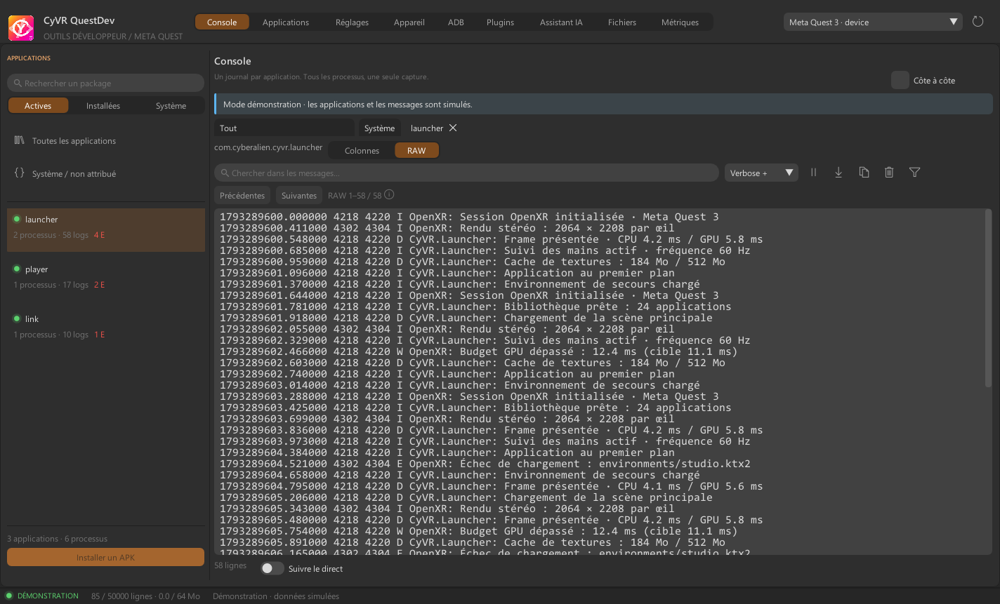
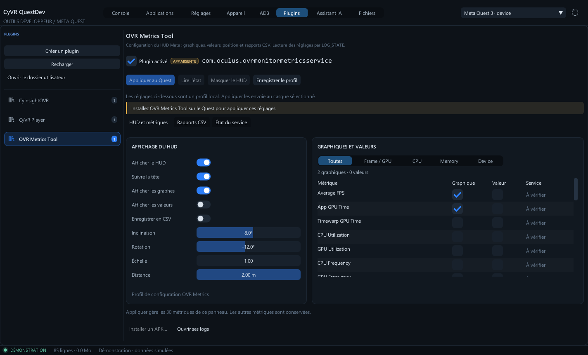
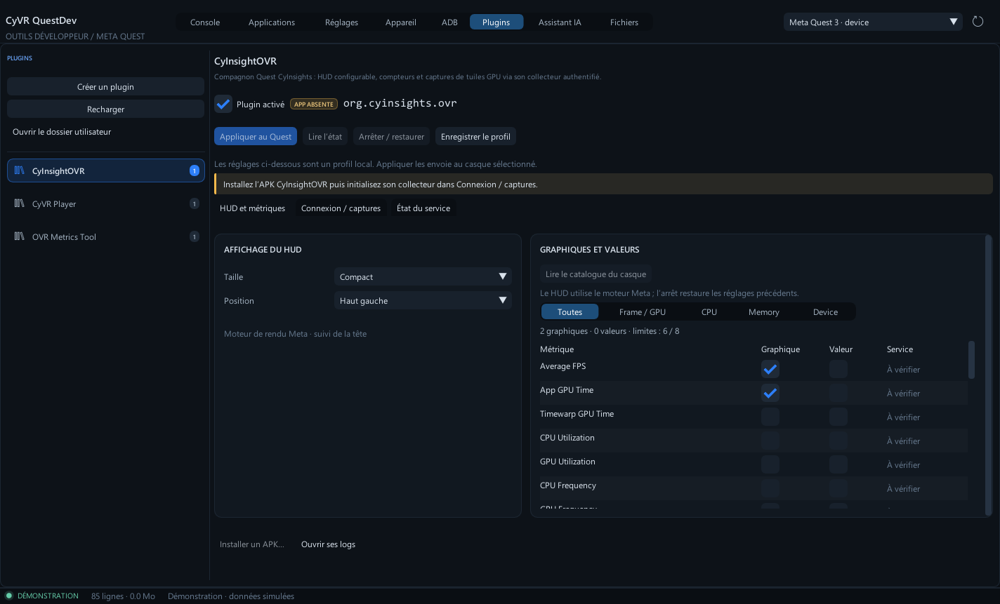

<p align="center">
  
</p>

# CyVR QuestDev 0.9

Outils de développement pour Meta Quest, en C++17, Win32 et DirectX 11, avec l’interface modulaire **CyUI 1.2**. Le panneau de texte commun est isolé dans une cible C++20.

Copyright © 2026 Cyberalien. Projet sous **GNU GPLv3 uniquement** (`GPL-3.0-only`) : [licence intégrale](LICENSE), [copyright et périmètre](COPYRIGHT). Les composants tiers conservent leurs propres licences, recensées dans [THIRD_PARTY.md](THIRD_PARTY.md).

Neuf espaces possèdent leur propre navigation : **Console, Applications, Réglages, Appareil, ADB, Plugins, Assistant IA, Fichiers et Métriques**. Une application conserve sa propre vue de logs, ses sous-processus et son historique, indépendamment des autres applications du casque.





## Démarrer

Télécharger **Windows-x64-Setup.exe** depuis la [release Alpha](https://github.com/MrMybal/CyVR_QuestDev/releases) pour installer l’app pour votre compte Windows, avec raccourcis et désinstallation. Aucun droit administrateur n’est demandé. Le **ZIP Windows x64** reste disponible pour une utilisation portable : extraire toute l’archive puis lancer `CyVR_QuestDev.exe`. Python et CyToolsCore sont embarqués ; ADB reste externe. Voir [l’installation](docs/INSTALLATION.md) et [la préparation des releases](docs/RELEASE.md).

Lancer `build/windows/CyVR_QuestDev.exe`. L’application détecte ADB dans le dossier de l’exécutable, le SDK Android ou le PATH. Le chemin peut être changé dans **Réglages**.

Brancher un Quest avec le mode développeur actif, puis accepter le débogage USB dans le casque. Si un seul appareil autorisé est présent, la connexion est automatique. Avec plusieurs appareils, choisir celui à observer dans la liste en haut.

Dans **Console**, la colonne de gauche propose **Actives**, **Installées** et **Système**. Un clic sur une app ouvre son journal dans un onglet. Les apps actives et celles qui émettent des logs passent en tête de liste. **Applications** possède ses propres catégories de gestion ; les autres pages ont leur propre navigation.

## Fonctions disponibles

- **Console** : reprise du suivi au retour en bas, vue **RAW** sélectionnable et copiable, tableau triable par colonne avec tris combinés. [Guide du journal](docs/LOGS.md).
- Navigation latérale adaptée à chaque page ; le gestionnaire d’applications affiche le nombre installé par catégorie et le nombre réellement affiché après recherche.
- **Device Actions** : cartes avec icônes et interrupteurs animés pour GPU, HUD/CSV, ADB Wi-Fi, proximité et Boundary ; mirroring H.264 avec audio PC, fenêtre vidéo, plein écran, qualité réglable, recadrage et MKV ; PNG, MP4, navigateur, Perfetto, récupération des CSV, veille/réveil et redémarrage. Les états non lus ou non vérifiés sont signalés. [Guide du mirroring](docs/MIRRORING.md).
- **ADB** : shell Android ou arguments ADB, sortie progressive, délai maximal, tâches concurrentes, annulation, historique et export.
- **Plugins** : OVR Metrics et CyInsightOVR configurables directement dans QuestDev, profils locaux, métriques/graphiques, placement du HUD, CSV, connexion au collecteur et captures GPU `.cyovr`. Manifestes `.cyplugin`, actions Android et tunnels TCP ADB forward/reverse. [Guide](docs/PLUGINS.md).
- **Fichiers** : volet Quest seul ou **PC / Quest côte à côte**, sélection multiple, navigation et filtres indépendants. Transfert immédiat ou **liste préparée optionnelle**, lancement séquentiel du lot, annulation par fichier ou de tout le lot, reprise et arrêt sur erreur. Création, renommage et suppression de fichiers/dossiers vides sur le Quest. [Guide](docs/FILES.md).
- **Métriques** : toutes les colonnes disponibles des CSV OVR, sélection des courbes, zoom et curseur communs, suivi des écritures du casque, enregistrement sur PC, ouverture et export CSV. [Guide](docs/METRICS.md).
- **Assistant IA** : discussion intégrée ou fenêtre séparée, contexte inspectable, choix du modèle, réponse progressive, annulation, politique des outils et configuration MCP.
- **MCP / SDK** : véritable runtime [CyToolsCore 0.10.1 MIT](https://github.com/MrMybal/CyToolsCore), adaptateurs officiels HTTP/MCP et dix-sept opérations communes avec l’interface native. Import automatique des sources locales et export durable des téléchargements et enregistrements.
- **Mises à jour GitHub** : canaux stable/Alpha, connexion au dépôt privé, téléchargement vérifié, installation avec redémarrage et sauvegarde/restauration de la version précédente. Depuis **Réglages → Mises à jour GitHub**. [Guide](docs/UPDATES.md).

- Capture simultanée des buffers Android `main`, `system`, `crash` et `events`.
- Journaux par package, y compris les processus `package:service` et `package:renderer`.
- Suivi des démarrages et arrêts ; l’historique reste rattaché au bon package quand un PID est réutilisé.
- Onglets par application et affichage de deux applications côte à côte, avec filtres indépendants.
- Recherche, exclusion, filtre de tag, PID et sévérité minimale.
- Pause d’affichage, suivi du direct, copie et inspecteur de message par double clic.
- Export de la vue filtrée en texte UTF-8 ou JSON Lines, avec package, processus, PID, TID, tag, niveau et timestamp.
- Installation d’un APK, lancement et arrêt d’une application.
- Détection des appareils déconnectés, non autorisés ou hors ligne ; nouvelle tentative de capture après interruption.
- Connexion Wi-Fi à un appareil dont ADB TCP/IP est déjà configuré.
- Cinq thèmes CyUI ; thème et chemin ADB enregistrés dans `%LOCALAPPDATA%/CyVR/QuestDev`.

Le tampon conserve par défaut **50 000 lignes / 64 Mo de données comptabilisées**. **Réglages → Limites du journal** permet de choisir de **1 000 à 5 000 000 lignes** et de **16 à 2 048 Mo**, avec des préréglages et une sauvegarde locale. La première limite atteinte retire les lignes les plus anciennes ; réduire les limites les applique immédiatement. La pause fige l’affichage, mais la capture continue. Le compteur du bas affiche les limites actives et les lignes retirées ou perdues si la file de réception sature.

Les processus d’origine incertaine restent dans **Système / non attribué**. Le logiciel ne devine pas leur application à partir d’un UID partagé. Les événements Android de gestion des processus servent à l’attribution et sont masqués par défaut ; les filtres avancés permettent de les afficher.

## Raccourcis

| Action | Raccourci |
| --- | --- |
| Actualiser les appareils et la capture | F5 |
| Suspendre / reprendre la vue principale | Espace |
| Exporter la vue principale en texte | Ctrl+S |
| Copier la ligne sélectionnée | Ctrl+C |
| Copier toute la vue filtrée | Ctrl+Maj+C |
| Vider le journal local | Ctrl+L |

## Compiler et vérifier

Prérequis : Windows 10/11 x64, Visual Studio 2022 avec les outils C++17/C++20, CMake/Ninja et Python 3. La révision CyUI est épinglée dans `cmake/CyUI.cmake`. Le script utilise un dépôt `CyUI` (ou l’ancien nom `CyImgui_Interface`) voisin, `CYUI_ROOT` ou `-CyUIRoot`, puis extrait le commit exact dans le cache de build. Les modifications du dépôt partagé restent intactes. CMake peut également récupérer directement ce commit. ADB est requis pour utiliser un casque ; il n’est pas redistribué dans ce projet. [Architecture et modules](docs/CYUI_MIGRATION.md).

```powershell
.\build.ps1 -Test
.\build.ps1 -Run
# Autre emplacement de CyUI :
.\build.ps1 -Test -CyUIRoot ../CyUI -BuildDirectory build/cyui-migration
# Installer / réparer le Python privé de l’assistant :
.\runtime\setup.ps1
.\runtime\python\Scripts\python.exe -m unittest discover -s assistant/tests -v
# Installer le moteur officiel du mirroring et ses sources correspondantes :
python tools/setup_mirroring.py
```

Les tests utilisent un faux exécutable ADB pour contrôler l’attribution, les redémarrages, la réutilisation de PID, les filtres, les limites mémoire, l’échappement JSON et les commandes du backend.

```powershell
# Captures des cinq thèmes et des différentes vues, sans casque :
python tools\verify_ui.py
# Vérification de la vue d’une app qui émet des logs sur un casque connecté :
python tools\verify_ui.py --live --package com.cyvr.player
```

Le mode de démonstration n’ouvre aucune connexion ADB :

```powershell
.\build\windows\CyVR_QuestDev.exe --demo
.\build\windows\CyVR_QuestDev.exe --demo --compare --theme light-grey
.\build\windows\CyVR_QuestDev.exe --package com.cyvr.player
.\build\windows\CyVR_QuestDev.exe --page 8 --metrics-csv C:\captures\session.csv
```

## IA et extensions

Le runtime privé dans `runtime/python` démarre avec QuestDev. La connexion au fournisseur IA reste explicite, dans **Assistant IA → Connecter / appliquer le profil**. **Codex** réutilise la connexion du CLI et peut appeler les outils natifs QuestDev. Claude Code, Ollama, OpenRouter, Anthropic, OpenCode et Antigravity proposent actuellement une discussion avec contexte ; leurs appels aux outils QuestDev intégrés ne sont pas encore implémentés. Les clients externes compatibles peuvent employer le MCP.

Le contexte contient l’appareil, les applications, les filtres, les plugins, les permissions, des indications d’utilisation et jusqu’à 50 messages de la vue. Il peut être inspecté et son inclusion automatique est réglable. Les outils gardent leur droit de lecture. Les clés API viennent d’une variable d’environnement ou du champ de session, sans sauvegarde dans le profil. Les actions IA/MCP/SDK demandent par défaut une confirmation dans QuestDev.

**Configuration MCP → Copier le JSON MCP** fournit la configuration réelle du client externe. Voir [la connexion IA, MCP et SDK](docs/AI_MCP_SDK.md), [l’exemple Python](examples/list_errors.py) et [le format des plugins](docs/PLUGINS.md). Garder les dossiers `assistant`, `runtime` et `plugins` avec ce projet : l’EXE seul ne contient pas Python. Python 3.11+ est requis pour créer le runtime.

## Périmètre de cette version

La capture commence à la connexion, en direct. Elle ne réattribue pas l’ancien tampon du casque à des PID actuels. Après une interruption, la nouvelle capture repart au présent ; les messages émis pendant l’interruption peuvent manquer. Une origine manquante dans les événements ou un nom de processus personnalisé non rattachable à un package reste non attribué. Les messages de crash émis par un processus système restent accessibles dans la vue globale et la vue système.

Le mirroring utilise scrcpy dans une fenêtre vidéo dédiée. Sa cadence dépend du casque, de l’application et de la liaison USB/Wi-Fi ; la duplication audio nécessite Android 13+ et peut être refusée par certaines apps. L’enregistrement du flux MKV continue jusqu’à l’arrêt du mirroring, sans limite de 180 secondes. La commande indépendante de vidéo Android MP4 reste limitée à 180 secondes et Perfetto à 120 secondes. Le HUD/CSV nécessite OVR Metrics installé ; son APK n’est pas redistribué. Un tunnel de plugin nécessite un vrai service TCP dans l’application cible. Les réglages VR dépendent du firmware et leur sortie est consultable dans ADB.

Les transferts concernent les fichiers réguliers. Les copies de dossiers, suppressions récursives, accès root, déploiements de bundles APK et outils Meta de simulation réseau/multijoueur ne sont pas implémentés. Cette version n’annonce pas une parité complète avec MQDH.

Voir [le gestionnaire de fichiers](docs/FILES.md) et [l’exemple de téléchargement avec export](examples/download_file.py). Les fonctions de fichiers de la version 0.3 sont validées avec le backend de test et le MCP natif ; le Quest était déconnecté pendant cette itération.

Voir [l’architecture](docs/ARCHITECTURE.md), [la validation](docs/VALIDATION.md) et [les notices des dépendances](THIRD_PARTY.md).




