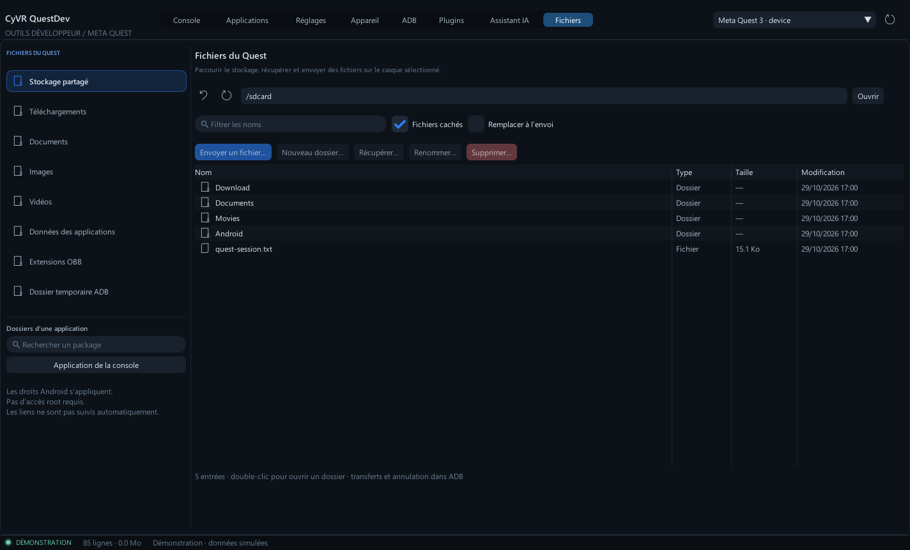

# Fichiers du Quest

L’onglet **Fichiers** parcourt le stockage accessible à ADB. La barre latérale propose le stockage partagé, Download, Documents, Pictures, Movies, les données/OBB des applications et `/data/local/tmp`. Rechercher un package pour ouvrir `/sdcard/Android/data/<package>/files`, ou reprendre l’application sélectionnée dans la console.



Double-cliquer sur un dossier pour l’ouvrir, ou saisir un chemin Android absolu. **Alt+Haut** remonte au parent ; **F5** actualise. Le filtre réduit les noms affichés et les fichiers cachés peuvent être masqués. La liste présente le type, la taille et l’heure locale de modification disponibles. Les liens affichent leur cible sans la suivre automatiquement.

- **Envoyer un fichier** conserve son nom dans le dossier courant. Une destination existante produit une erreur, sauf si l’option de remplacement est activée et confirmée.
- **Récupérer** télécharge un fichier régulier vers un emplacement local choisi. Un temporaire est finalisé après succès ; une annulation conserve l’ancien fichier local.
- **Nouveau dossier**, **Renommer**, **Supprimer** montrent la cible avant confirmation. Renommer ne remplace pas une autre entrée. Un dossier doit être vide pour être supprimé. Supprimer un lien retire seulement le lien.
- Le transfert actif propose une annulation et **Sortie ADB** pour consulter ses détails. Les tâches restent accessibles dans l’historique ADB.

Les envois utilisent aussi un temporaire distant. Si le casque est débranché avant le nettoyage, ce temporaire peut rester et l’erreur apparaît dans ADB. Les transferts de dossiers et les suppressions récursives ne sont pas pris en charge.

Android conserve ses restrictions : un dossier peut être absent ou interdit. L’app ne contourne pas ses permissions et ne demande pas le root. Les listes de plus de 5 000 entrées sont signalées comme tronquées. Les noms restent des arguments littéraux, même avec espaces ou apostrophes. Les commandes utilisent les utilitaires Android [Toybox](https://android.googlesource.com/platform/external/toybox/+/refs/heads/main/android/linux/generated/help.h).

## MCP / SDK

`list_files`, `pull_file`, `push_file`, `file_action` et `navigate(page='files')` réutilisent les mêmes commandes que l’interface. Les listes sont paginées (`offset`, `limit`, `nextOffset`). Les écritures respectent la politique d’action de l’app, y compris pour les clients externes.

CyToolsCore importe automatiquement `sourceFile` dans son espace privé, en conservant l’original. Les téléchargements Core sont temporaires : exporter les résultats avant de fermer la tâche.

```powershell
# QuestDev doit être ouvert et connecté :
.\runtime\python\Scripts\python.exe examples\download_file.py /sdcard/Download/report.txt D:\Exports\Quest
```

Le script attend le job, appelle l’export officiel et affiche le fichier durable. Voir [les contrats et permissions](AI_MCP_SDK.md).

## Vérification

Les commandes ont été exécutées sur des fichiers de test avec le shell POSIX de Git. L’interface et le MCP ont été vérifiés avec le faux ADB : listes binaires, pagination, erreurs d’accès, téléchargements, exports persistants et annulation. **Le Quest n’était pas connecté pendant cette itération** ; ces preuves restent distinctes d’une validation sur son firmware.
