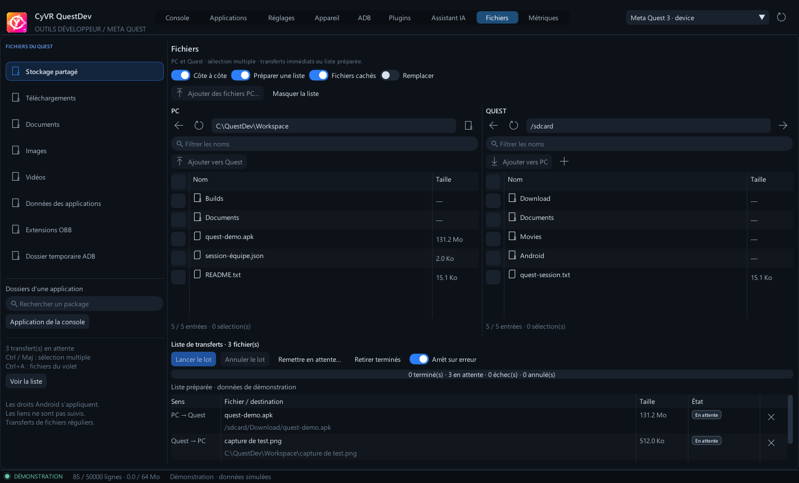

# Fichiers PC / Quest

L’onglet **Fichiers** parcourt le stockage accessible à ADB. La barre latérale propose le stockage partagé, Download, Documents, Pictures, Movies, les données/OBB des applications et `/data/local/tmp`. Rechercher un package pour ouvrir `/sdcard/Android/data/<package>/files`, ou reprendre l’application sélectionnée dans la console.


Double-cliquer sur un dossier pour l’ouvrir, ou saisir un chemin absolu. **Alt+Haut** remonte au parent ; **F5** actualise le volet pointé. Les filtres réduisent les noms affichés et les fichiers cachés peuvent être masqués. Les icônes distinguent dossiers, fichiers et liens ; taille et date apparaissent selon la largeur disponible. Le clic droit propose la copie du chemin et la cible d’un lien, sans la suivre automatiquement.

**Côte à côte** ajoute le volet PC à gauche et le Quest à droite. Chaque volet possède son adresse, son filtre et sa sélection. Les cases, **Ctrl+clic**, **Maj+clic** et **Ctrl+A** permettent de sélectionner plusieurs fichiers. La case d’en-tête sélectionne les fichiers réguliers visibles. **Envoyer vers Quest** utilise le dossier Quest courant ; **Récupérer vers PC** utilise le dossier PC courant. Le bouton de dossier du volet PC ouvre le sélecteur Windows. Les options de disposition et de préparation sont mémorisées.



## Préparer puis lancer un lot

Activer **Préparer une liste**, puis ajouter les fichiers sélectionnés, depuis un volet ou le sélecteur Windows multiple. Les chemins source/destination, le casque et l’autorisation de remplacement sont fixés lors de l’ajout. Parcourir ensuite d’autres dossiers ne change pas les lignes préparées. La liste est conservée pendant la session de l’app ; elle n’est pas relancée au démarrage.

**Lancer le lot** traite les lignes dans l’ordre, une à la fois, en arrière-plan. Chaque ligne indique son sens, sa taille et son état. L’option **Arrêt sur erreur** suspend le lot dès un échec ; la désactiver permet de continuer les autres lignes. **Remettre en attente…** propose les échecs seuls, ou les échecs et annulations, puis il faut relancer le lot. Une destination déjà présente dans la liste doit être retirée avant d’être réutilisée.

La croix d’une ligne annule ce fichier ; **Annuler le lot** annule les lignes en attente et demande l’arrêt du transfert actif. Les fichiers déjà terminés restent en place. Changer de casque ou le déconnecter suspend le lot ; les lignes en attente restent liées à leur appareil d’origine. Reconnecter cet appareil et relancer explicitement la liste. Un transfert interrompu peut être remis en attente avec **Remettre en attente…**. La liste est limitée à 2 000 fichiers. Les mises à jour/redémarrages de l’app demandent de terminer ou d’annuler la liste.

Lorsque **Préparer une liste** est désactivé, les nouveaux transferts démarrent immédiatement et restent annulables dans la liste. Les sources sont revalidées au démarrage de chaque fichier. Seuls les fichiers réguliers sont transférés ; sélectionner un dossier sert à le parcourir.

- **Envoyer des fichiers PC** conserve leurs noms dans le dossier courant. **Remplacer** est désactivé initialement ; son activation autorise le remplacement pour les nouvelles lignes uniquement et affiche un rappel. Le choix de chaque ligne est consultable dans son infobulle.
- **Récupérer** télécharge un fichier régulier vers un emplacement local choisi. Un temporaire est finalisé après succès ; une annulation conserve l’ancien fichier local.
- **Nouveau dossier**, **Renommer**, **Supprimer** montrent la cible avant confirmation. Renommer ne remplace pas une autre entrée. Un dossier doit être vide pour être supprimé. Supprimer un lien retire seulement le lien.
- Les états et erreurs apparaissent dans la liste ; les tâches et leurs sorties restent accessibles dans l’historique ADB.

Les envois utilisent aussi un temporaire distant. Si le casque est débranché avant le nettoyage, ce temporaire peut rester et l’erreur apparaît dans ADB. Les transferts de dossiers et les suppressions récursives ne sont pas pris en charge.

Android conserve ses restrictions : un dossier peut être absent ou interdit. L’app ne contourne pas ses permissions et ne demande pas le root. Les listes PC et Quest sont limitées à 5 000 entrées. Les noms restent des arguments littéraux, même avec espaces ou apostrophes. Un nom Android incompatible avec Windows doit être renommé avant sa récupération. Les commandes utilisent les utilitaires Android [Toybox](https://android.googlesource.com/platform/external/toybox/+/refs/heads/main/android/linux/generated/help.h).

## MCP / SDK

`list_files`, `pull_file`, `push_file`, `file_action` et `navigate(page='files')` réutilisent les mêmes commandes que l’interface. Les listes sont paginées (`offset`, `limit`, `nextOffset`). Les écritures respectent la politique d’action de l’app, y compris pour les clients externes.

CyToolsCore importe automatiquement `sourceFile` dans son espace privé, en conservant l’original. Les téléchargements Core sont temporaires : exporter les résultats avant de fermer la tâche.

```powershell
# QuestDev doit être ouvert et connecté :
.\runtime\python\Scripts\python.exe examples\download_file.py /sdcard/Download/report.txt D:\Exports\Quest
```

Le script attend le job, appelle l’export officiel et affiche le fichier durable. Voir [les contrats et permissions](AI_MCP_SDK.md).

## Vérification

Les commandes ont été exécutées sur des fichiers de test avec le shell POSIX de Git. L’interface et le MCP sont vérifiés avec le faux ADB : listes binaires, pagination, erreurs d’accès, téléchargements, exports persistants et annulation. Les tests de lots vérifient l’ordre, l’isolation des casques, les collisions Windows, le refus des remplacements par défaut, la finalisation atomique et le nettoyage après annulation. Ces vérifications restent distinctes d’une validation de transferts sur le firmware d’un Quest réel.
