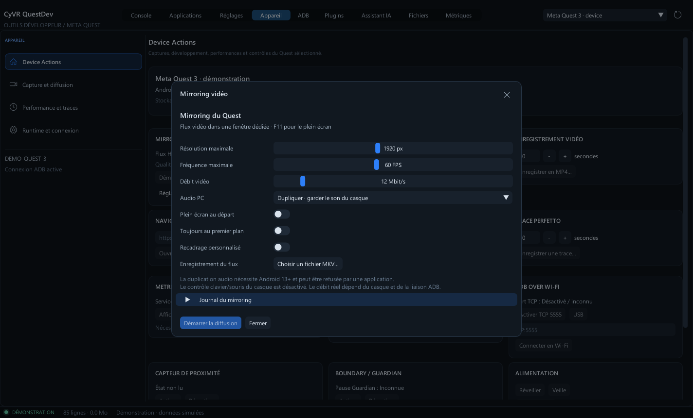

# Mirroring vidéo et audio

Brancher le Quest et accepter le débogage USB, puis ouvrir **Appareil → Mirroring vidéo / audio → Démarrer le mirroring…**. Sélectionner la résolution maximale, la fréquence, le débit et l’audio, puis **Démarrer la diffusion**. Une fenêtre vidéo native s’ouvre sur le PC. **Voir la vidéo** la ramène au premier plan ; **F11** bascule le plein écran. La fenêtre peut être redimensionnée.

Les valeurs initiales sont **1920 px, 60 FPS, 12 Mbit/s, H.264 avec décodage matériel automatique**. Ce sont des limites demandées ; les dimensions et la cadence reçues sont affichées dans QuestDev. Une cadence de 120 FPS n’est pas garantie. Réduire résolution ou débit si la liaison sature. ADB Wi-Fi fonctionne si le casque est déjà connecté ; démarrer le mirroring ne modifie pas sa configuration réseau.

Trois modes audio sont disponibles : désactivé, duplication sur PC en gardant le son du casque, ou sortie PC seulement. La duplication requiert Android 13+ et une application autorisant la capture audio. Un refus audio apparaît dans le journal ; une piste silencieuse peut aussi dépendre de l’application. Aucun microphone n’est capturé.

**Recadrage personnalisé** expose largeur, hauteur et décalages X/Y dans les coordonnées de l’écran du casque. Le découpage exact d’un œil dépend du modèle et du firmware. Le moteur signale un rectangle refusé dans son journal.

## Enregistrer

Avant le démarrage, choisir un fichier **MKV** dans les réglages. La vidéo et l’audio activé sont enregistrés simultanément à l’affichage. Le remplacement d’un fichier existant demande la confirmation du sélecteur Windows. Le choix est remis à zéro au démarrage pour éviter de réécrire le même fichier lors d’une autre session.

**Arrêter et finaliser**, fermer la fenêtre vidéo ou fermer QuestDev termine normalement le MKV. Le changement de casque et la déconnexion arrêtent aussi la session. Un arrêt forcé après blocage du moteur est signalé et peut laisser un fichier incomplet. Le journal est borné et copiable depuis **Réglages / journal** ; le dernier fichier est accessible depuis ce panneau.

Cet enregistrement est indépendant de la commande Android MP4 et ne possède pas sa limite de 180 secondes. L’espace disque disponible reste une contrainte.

## Moteur et développement

Les archives Windows incluent le moteur officiel [scrcpy 5.0.1](https://github.com/Genymobile/scrcpy/tree/v5.0.1), sous Apache-2.0, et ses DLL. ADB reste externe. Le moteur est lancé et supervisé par QuestDev ; il utilise l’ADB sélectionné, dans un environnement enfant isolé. Le contrôle distant et la synchronisation du presse-papiers sont désactivés. Le lancement ne démarre aucun jeu et ne change pas les réglages de veille du casque.

Depuis les sources : `python tools/setup_mirroring.py`. Les téléchargements officiels sont vérifiés par SHA-256. `--offline` réutilise et vérifie le cache. Les binaires sont installés dans `runtime/mirror`, les sources tierces dans `runtime/mirror-sources`, tous deux exclus de Git. L’archive Source de la release fournit ces sources et les scripts de compilation du dépôt scrcpy. Les licences restent dans `LICENCES` ; les DLL LGPL peuvent être remplacées par des versions compatibles.

Le paramètre de développement `--scrcpy <chemin-absolu>` permet de sélectionner un autre moteur compatible. `--mirror-settings` ouvre directement le panneau de réglages. Les tests utilisent un moteur simulé, puis un mode matériel facultatif : `quest_mirroring_tests.exe --live <scrcpy.exe> <adb.exe> <serial>`. Ce dernier affiche et enregistre quelques secondes du contenu actuel ; il ne lance aucune application.

## IA / MCP / SDK

`device_action` accepte `mirror_start` et `mirror_stop`, avec la permission `deviceControl` et la confirmation habituelle de QuestDev. Le démarrage n’est acquitté qu’après réception des dimensions vidéo et création de la fenêtre ; l’arrêt attend la fin du moteur. `get_context.context.mirroring` indique état, dimensions, FPS, audio demandé et enregistrement.

```python
quest.invoke('device_action', {
    'action': 'mirror_start',
    'mirror': {'maxSize': 1600, 'maxFps': 60, 'bitRateMbps': 12,
               'audio': 'duplicate', 'fullscreen': False}
})
quest.invoke('device_action', {'action': 'mirror_stop'})
```

Le choix du fichier MKV reste dans l’interface native. Le SDK ne reçoit ni les images du flux ni son journal brut automatiquement.


