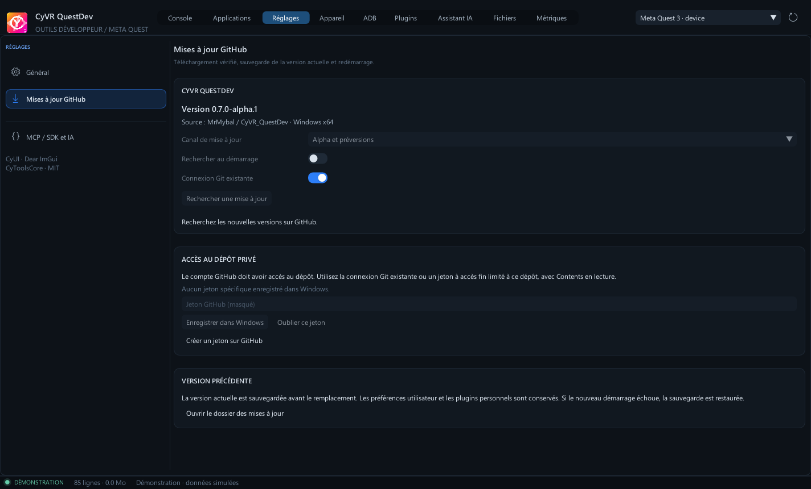

# Mettre QuestDev à jour depuis l’application

Cette fonction est disponible à partir de **0.7.0-alpha.1**. Les anciennes versions doivent télécharger et extraire cette première archive manuellement. Ensuite, ouvrir **Réglages → Mises à jour GitHub**.

## Rechercher et télécharger

Choisir **Alpha et préversions** pour recevoir les Alpha ; le canal stable ignore les préversions. **Rechercher une mise à jour** sélectionne la version publiée la plus récente selon son numéro, sans proposer de retour à une version plus ancienne. Les brouillons et les distributions incompatibles sont exclus. La recherche au démarrage est facultative et désactivée initialement. Une version trouvée déclenche une notification ; son téléchargement reste explicite.

Le dépôt étant privé, le compte doit y avoir accès. **Connexion Git existante** réutilise les identifiants disponibles via Git Credential Manager, sans ouvrir de demande de connexion en arrière-plan. Git reste facultatif : un jeton à accès fin peut être saisi dans le champ masqué, avec uniquement ce dépôt sélectionné et la permission **Contents : lecture**. Le jeton est conservé dans le Gestionnaire d’identifiants Windows. **Oublier ce jeton** retire uniquement l’entrée propre à QuestDev, sans déconnecter Git ni les fournisseurs IA.

**Télécharger et vérifier** récupère le ZIP Windows x64, contrôle son SHA-256 contre les métadonnées GitHub et `SHA256SUMS.txt`, puis vérifie le manifeste de tous les fichiers extraits. Les redirections vers les serveurs de fichiers GitHub ne transmettent pas le jeton d’API. Le téléchargement peut être annulé ; un paquet incomplet ou refusé n’est pas installé.

## Installer et restaurer

**Installer et redémarrer** prépare la nouvelle installation à côté du dossier actuel. Un programme séparé, copié hors de ce dossier, attend la fermeture normale de QuestDev. L’ancien dossier devient une sauvegarde avant le remplacement. Le nouveau processus doit confirmer son démarrage, avec son interface et ses services Core/mise à jour disponibles. Si ce démarrage échoue, le programme tente de restaurer et relancer la sauvegarde.

Les préférences sous `%LOCALAPPDATA%/CyVR/QuestDev` restent en place. Les fichiers personnels supplémentaires et les plugins ajoutés dans le dossier de l’app sont conservés, y compris lors d’une restauration. Si un fichier livré avec l’application a été modifié ou si un fichier personnel entre en conflit avec un nouveau composant, l’installation automatique est refusée avant le remplacement. La préparation conserve une copie intégrale de l’installation précédente.

**Restaurer et redémarrer** revient à la sauvegarde associée au dossier courant. Les sauvegardes ne sont pas supprimées automatiquement. **Ouvrir le dossier des mises à jour** permet de consulter les téléchargements et les résultats ; les sauvegardes de l’application sont dans des dossiers voisins du dossier installé.

L’installation nécessite un dossier dédié et modifiable, issu du ZIP portable ou de l’installateur par utilisateur (Alpha 2 et suivantes). Les fichiers de désinstallation et les raccourcis de l’installation Windows sont conservés lors des mises à jour et restaurations. Elle est désactivée pour les builds de développement, les copies Git et les dossiers système ; aucune élévation administrateur n’est lancée. Les liens/jonctions sont refusés dans l’arbre remplacé. Un grand volume de fichiers personnels dans le dossier de l’app peut nécessiter une installation manuelle dans un dossier dédié. Arrêter les enregistrements et le mirroring avant l’installation.

## Développement

`VERSION` est la source du numéro de release pour CMake, l’exécutable, le worker de mise à jour et le packager. `UPDATE-MANIFEST.json` est généré dans le paquet Windows et inventorie ses fichiers. Les futurs builds doivent conserver le protocole `--update-ready-file` pour confirmer le redémarrage.

Le worker `updater/service.py` utilise uniquement la bibliothèque standard Python. Les commandes passent par des pipes locaux distincts de l’assistant IA. Le SDK/MCP peut lire un résumé d’état dans `get_context`, mais la connexion et l’installation restent des actions de l’interface native.

Vérifier avec `python -m unittest discover -s updater/tests -v`, puis `python tools/verify_updates.py --product <dossier-Windows-extrait> --output <nouveau-dossier-de-test>`. Le second test utilise des copies jetables, le Python embarqué et de vrais redémarrages de QuestDev ; il vérifie aussi la restauration et les fichiers personnels.

Références : [releases GitHub](https://docs.github.com/en/rest/releases/releases), [téléchargement des assets et permission Contents](https://docs.github.com/en/rest/releases/assets), [Gestionnaire d’identifiants Windows](https://learn.microsoft.com/en-us/windows/win32/api/wincred/nf-wincred-credwritew).

